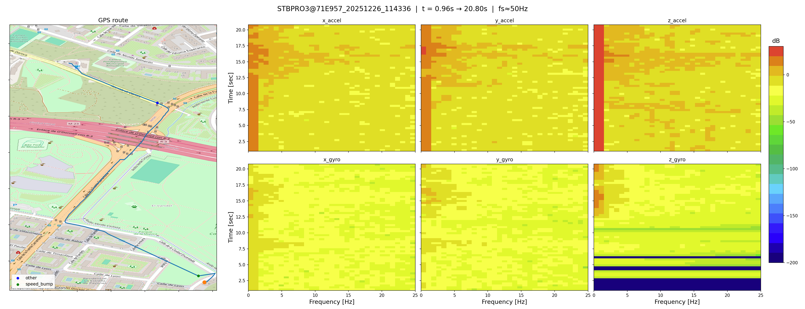

# Video CLI

The video CLI lives in `potholes.tools.video`. Run commands from the repository root.

```powershell
python -m potholes.tools.video --help
```

## Commands

### Generate a session video

Creates an MP4 video with the spectrogram panels and GPS route map.
Requires `ffmpeg` on PATH and downloads map tiles unless cached.

Usage:
```shell-session
$ uv run -m potholes.tools.video --help

Usage: python -m potholes.tools.video [OPTIONS] SESSION_FILE

Options:
  -o, --output PATH  Write the video to this file (extension not needed, .mp4 will be added).
  -d, --debug  Debug mode, renders only a single frame as a png.
  --help  Show this message and exit.
```

Example:
```shell-session
$ uv run -m potholes.tools.video output/session_*/session_*.csv -o out/session_video

Rendering video: 100%|##########| 240/240 [00:32<00:00,  7.45it/s]
```
<video controls width="900">
    <source src="../../assets/cli/test_video.mp4" type="video/mp4" />
</video>

### Generate a debug frame

Renders a single PNG frame instead of a full video.

Example:
```shell-session
$ uv run -m potholes.tools.video output/session_*/session_*.csv -o out/frame -d

(no stdout; writes out/frame.png)
```


### Background maps

Video generation downloads OpenStreetMap tiles for the route extent. Requests identify
this application as `PotholesDetection/0.1`. Tiles are cached across runs in
`%LOCALAPPDATA%/PotholesDetection/map-tiles` on Windows (or
`~/.cache/PotholesDetection/map-tiles` when `LOCALAPPDATA` is unavailable).
Keep this cache so repeated renders reuse downloaded tiles.

You can include a real contact URL or email in the application identifier by setting
`POTHOLES_MAP_USER_AGENT` before rendering. Do not impersonate a browser or another
application. See the [OpenStreetMap tile usage policy](https://operations.osmfoundation.org/policies/tiles/).

If a video contains an “Access blocked” tile, regenerate it after correcting the map
request configuration. Existing MP4 files cannot update their background automatically.
An existing server or network block may still require resolution with the provider;
do not repeatedly retry blocked requests.
