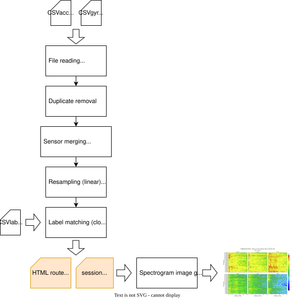

# Processing pipeline

The preprocessing pipeline generates the data files needed for further processing in machine learning systems. To do
it it does the following steps:

1. Discovers sensor sessions from `metadata*.yaml`.
2. Loads accelerometer, gyroscope, GPS, and labels.
3. Resamples to a uniform rate and merges labels.
4. Writes a session CSV and an HTML route map.
5. Optionally generates spectrogram samples for training.

## Workflow diagram

Select the diagram to open the full-size SVG.
